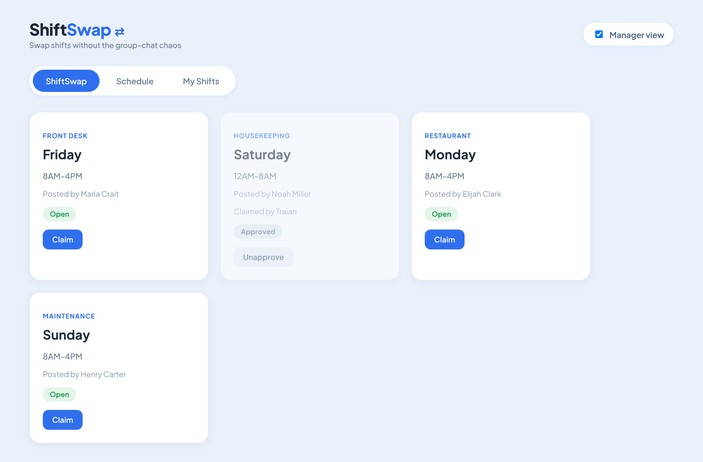

# ShiftSwap ⇄

**Swap shifts without the group-chat chaos.**

ShiftSwap is a small web app for teams that work in shifts (for example a hotel). An employee who can't cover a shift posts it, a colleague claims it with one click, and a manager approves the swap before it becomes final.

> Status: early prototype (front end only). Built as a personal project to learn how software is built **and tested**.



## How it works

```
 Open  ──Claim──▶  Claimed  ──Approve (manager)──▶  Approved 🔒
  ▲                  │                                  │
  └─────Unclaim──────┘                                  │
  ▲                                                     │
  └──────────────────Unapprove (manager)────────────────┘
```

- **Employees** see the board of posted shifts and can **Claim** or **Unclaim** them.
- **Managers** (toggle *Manager view*) can also **Approve** a claimed shift or **Unapprove** an approved one.
- Every action checks the current state first, so you can't approve a shift nobody claimed or claim one that is already approved.

## Run it

No install needed. Download the repo and open `index.html` in any modern browser (Chrome, Edge, Firefox).

Data is saved in the browser's `localStorage`, so it survives a page refresh. To start over, open DevTools (F12) → Console and run `localStorage.clear()`, then refresh.

## Project structure

| File | What it is |
| --- | --- |
| `index.html` | The whole app: layout, styles and JavaScript |
| `ShiftSwap.Project.xlsx` | Sample test data: 29 fictional employees in 6 departments and their weekly schedule |
| `TEST-CASES.md` | Test cases, results, and the bugs I found and fixed |

The JavaScript is split into a **data layer** (`getShifts`, `saveShifts`, `updateShiftsStatus`) and the **app** (rendering and button actions). The data layer is the only part that touches storage, so later it can read from an Excel import or a database without rewriting the UI.

## Built with

HTML, CSS, JavaScript (no frameworks) · browser `localStorage` · Chrome DevTools for debugging

## Testing

I test every feature manually and keep the results in **[TEST-CASES.md](TEST-CASES.md)**, together with bug reports for the problems I found, including how I reproduced and fixed them.

## Roadmap

- [ ] Import the weekly schedule from Excel and filter it by department
- [ ] Logins with roles (employee / manager), identified by Employee ID
- [ ] *My Shifts* tab: each employee sees only their own shifts
- [ ] Only the person who claimed a shift can unclaim it
- [ ] Security (escape user data before showing it) and cloud storage

## Author

Traian Ciocanu · Business Informatics student, Lucian Blaga University of Sibiu
